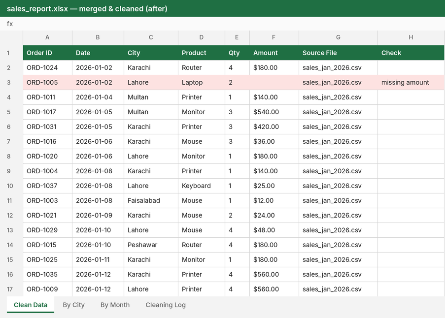
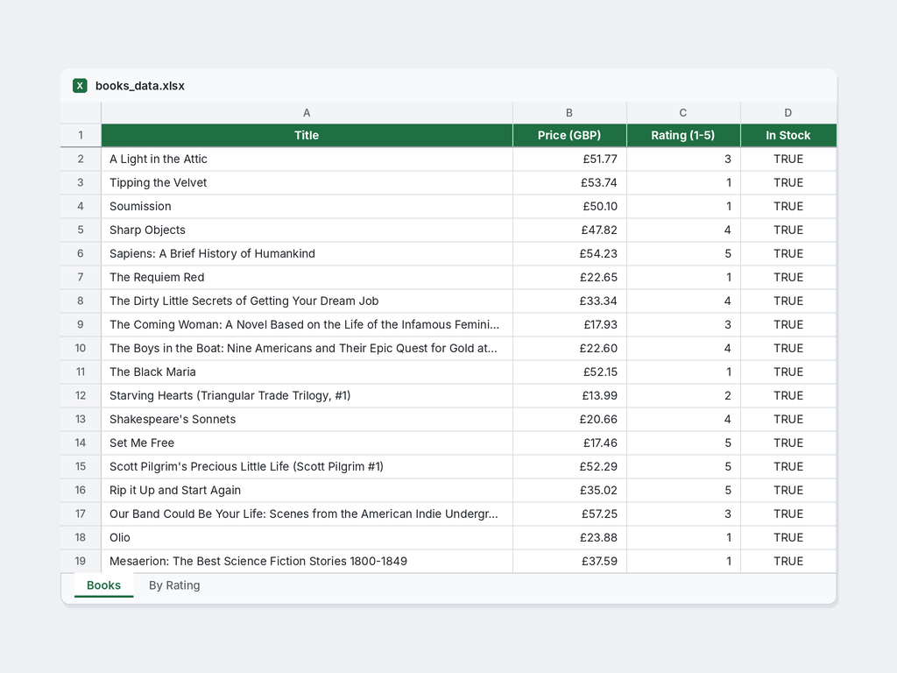
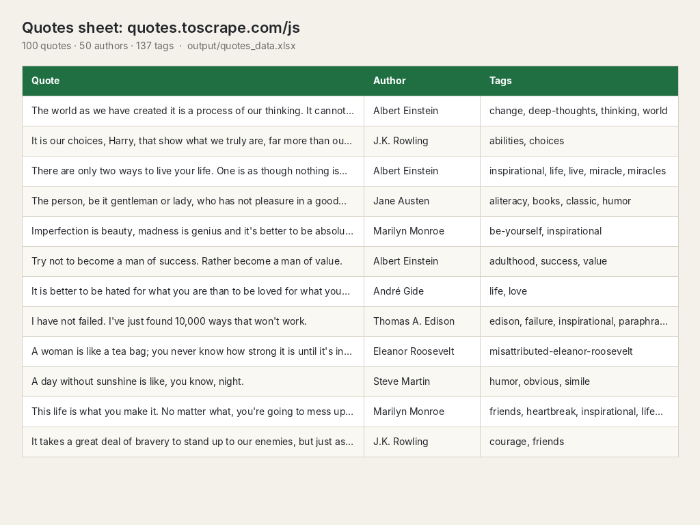
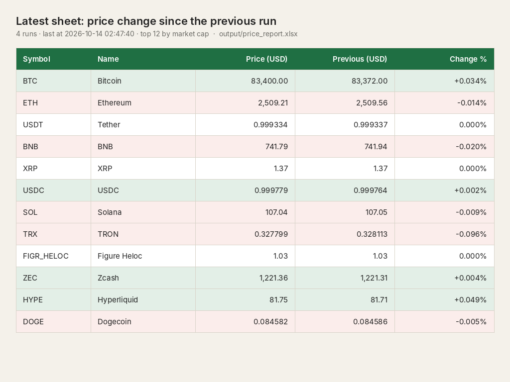

# Python Automation Portfolio

Python scripts for data cleaning, Excel automation and web scraping.

## excel-cleaner

Merges every CSV/Excel file in `input/`, fixes duplicates, blank rows, mixed date formats, inconsistent city names and messy amounts, then writes one formatted report (`output/sales_report.xlsx`) with summary sheets and a cleaning log. Rows it can't fix are highlighted for review.

```
cd excel-cleaner
pip install -r requirements.txt
python clean_report.py
```

Details: [excel-cleaner/README.md](excel-cleaner/README.md)



## web-scraper

Scrapes [books.toscrape.com](https://books.toscrape.com), a public practice site, following pagination. It saves title, price, rating, stock status and URL to `output/books_data.xlsx`, plus a summary sheet by rating.

```
cd web-scraper
pip install -r requirements.txt
python scraper.py --pages 3
```

Details: [web-scraper/README.md](web-scraper/README.md)



## js-scraper

Scrapes [quotes.toscrape.com/js](https://quotes.toscrape.com/js/), a practice site that only shows its content after JavaScript runs. A headless browser (Playwright) waits for each page to render and follows pagination. It saves every quote's text, author and tags to `output/quotes_data.xlsx`, with sheets counting quotes by author and by tag.

```
cd js-scraper
pip install -r requirements.txt
python scraper_js.py --pages 2
```

Details: [js-scraper/README.md](js-scraper/README.md)



## price-tracker

Collects live crypto prices from the CoinGecko public API on a schedule, keeps every run in a local SQLite history, compares each run with the previous one and flags moves above a threshold. It rebuilds `output/price_report.xlsx` with Latest, Alerts and History sheets and a price chart.

```
cd price-tracker
pip install -r requirements.txt
python tracker.py --every 10 --runs 4
```

Details: [price-tracker/README.md](price-tracker/README.md)



## Tech used

Python, pandas, openpyxl, requests, BeautifulSoup, Playwright, SQLite
