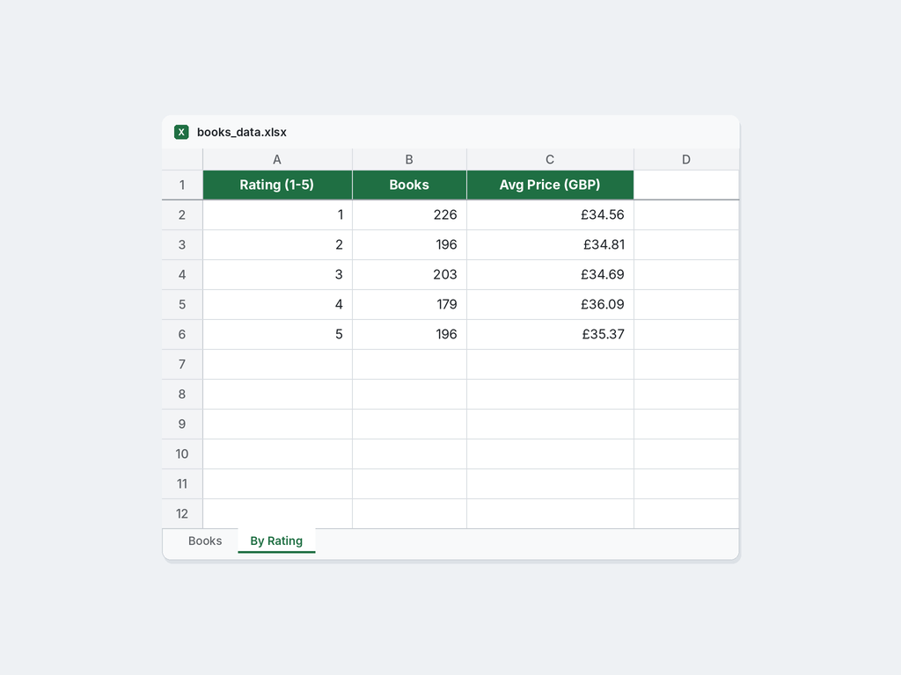
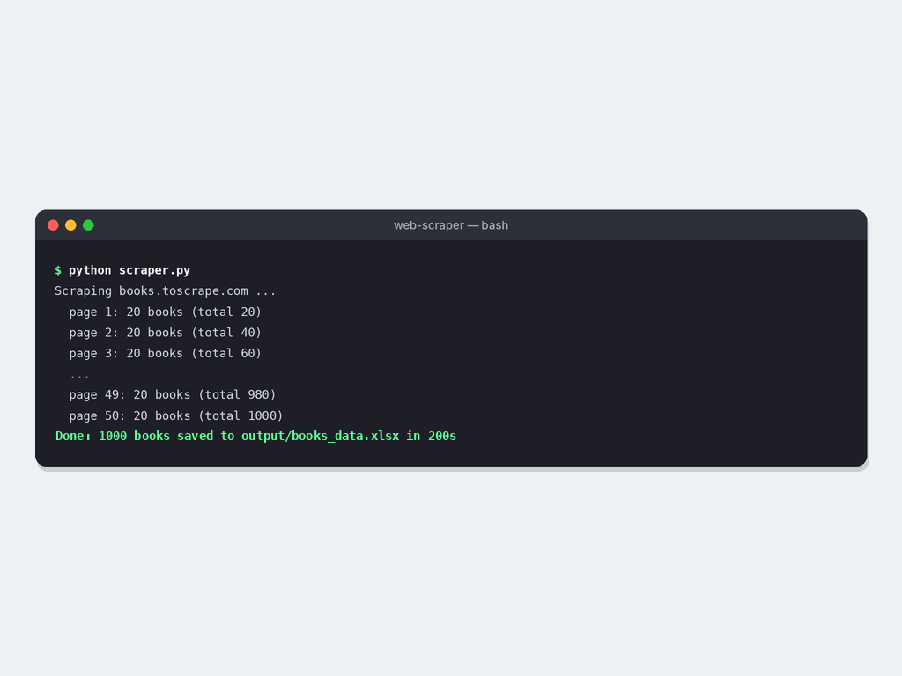

# Web Scraper: Book Catalogue to Excel

Scrapes https://books.toscrape.com (a public site made for scraping practice),
follows pagination, and saves title, price, rating, stock status and URL to Excel,
plus a summary sheet by rating.

## Run
```
pip install requests beautifulsoup4 pandas openpyxl
python scraper.py --pages 3   # quick test
python scraper.py             # all 50 pages, about 1,000 books (about 3 minutes, 1 request/sec)
```
Output: `output/books_data.xlsx`

## Screenshots





